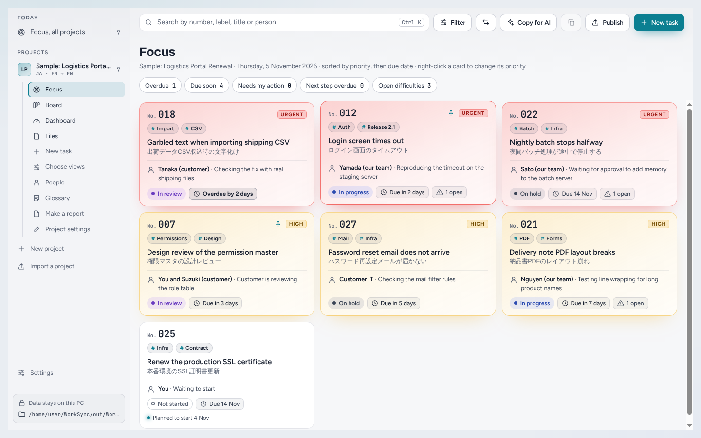
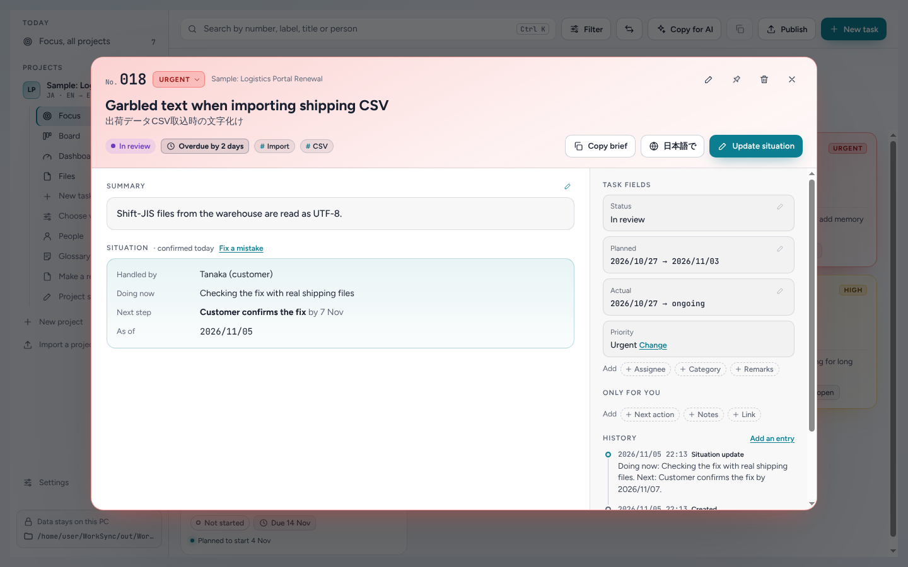
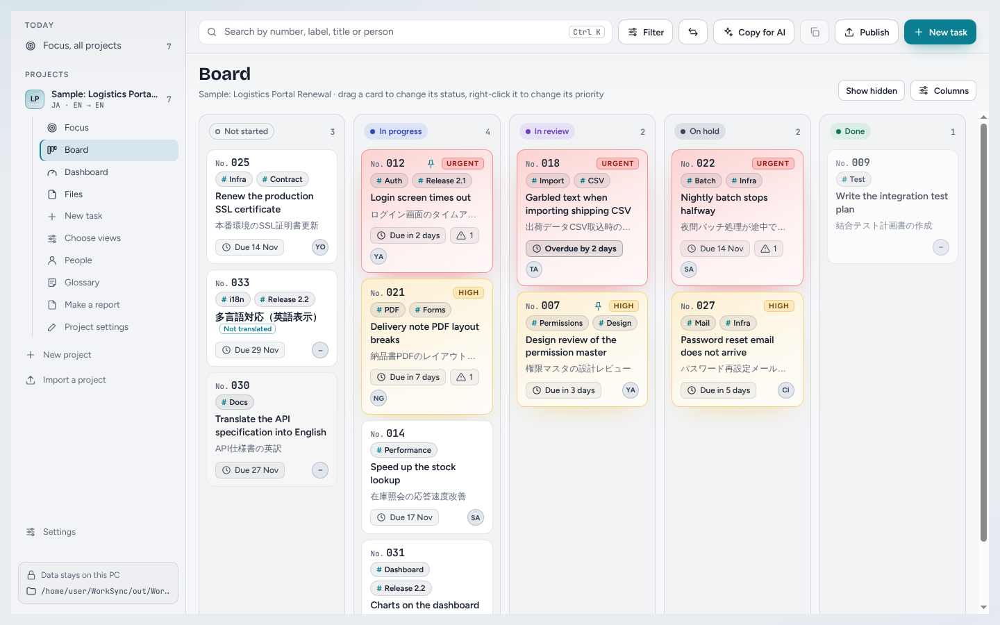
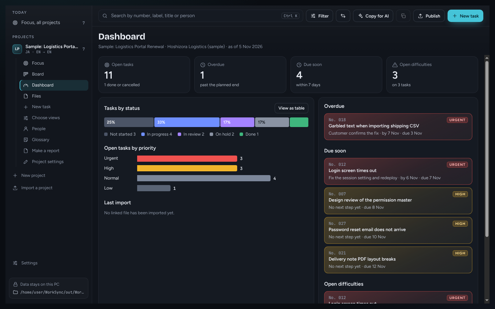

# WorkSync

**A desktop task tracker for project managers whose customers send task lists
as Excel files in another language.**

Some customers keep the task list in a spreadsheet written in Japanese. They
update it every few days and expect you to follow along. WorkSync reads that
file, keeps your translation, summary and current situation next to each task,
and shows the work as cards, a board, a timeline and a dashboard. When
something changes, it writes your updates back into **your own copy** of the
customer's file. The original is never touched.

It runs from an unzipped folder: no installer, no administrator rights, no
server and no account. Your data stays on your PC.



---

## Contents

- [Features](#features)
- [Download and run](#download-and-run)
- [First steps](#first-steps)
- [Your data](#your-data)
- [Sharing with others](#sharing-with-others)
- [Building from source](#building-from-source)
- [Known limitations](#known-limitations)
- [License](#license)

## Features

**Customer files**

- Link an `.xlsx`, `.xlsm`, `.xls` or `.csv` file by its path. Set up the
  columns once, then review each new version before anything changes:
  added, changed and removed rows are listed for you to accept.
- Write your changes back into your own copy of the file, cell by cell, so
  the layout and formatting stay as they were.

**Your understanding of each task**

- A translation, a short summary and the current situation (who handles it,
  what is happening, difficulties, the next step) for every task.
- Private notes and a next action that only you see.
- A glossary per project, so product names and terms translate the same way
  every time. A people list matches the names used in the file to the people
  you mean.

**Views**

- **Focus**: what needs attention today, sorted by priority and due date.
- **Board**: drag cards between statuses. You can hide status columns or add
  your own.
- **Tasks** table, **Timeline**, **Calendar** and **Dashboard**. Filters work
  in every view.

**Translation with AI, without an API key**

- **Copy for AI** builds one request for many tasks, with your glossary. Paste
  it into an AI chat such as Gemini, paste the answer back, and WorkSync checks
  it before filling in translations and summaries.

**Reports and sharing**

- Excel and Word reports, including reports in the customer's language with
  your notes translated.
- Publish a read-only web page and an Excel export to a shared folder, for
  colleagues who don't use WorkSync.
- Export a whole project as a `.worksync` file for another WorkSync user to
  import.

**Your own things, next to the projects**

- **My tasks**: personal to-dos that belong to no project, with Windows
  reminders by status and priority (urgent ones every 3 hours, others in the
  morning or afternoon). Completing one removes it, with Undo.
- **Notes**: notes on their own or attached to a project, with tags,
  favorites, search and clickable links. They save as you type.
- **Catalog**: the apps, files and folders you open often. On Windows it also
  finds files on your PC with [Everything](https://www.voidtools.com/), and a
  shortcut (Ctrl+Shift+F by default) opens a quick-search box from any app.

**Everyday comforts**

- English or Japanese screens, following your system or chosen in Settings.
- Light and dark mode, following your system or chosen in Settings.
- Keeps running in the tray when you close the window, for reminders and the
  shortcut. It never starts with your computer.
- Daily backups, with restore from Settings.
- English, Japanese and Vietnamese as task languages.

| Task details                                                                   | Board                                  |
| ------------------------------------------------------------------------------ | -------------------------------------- |
|  |  |



## Download and run

Get the latest version from the
[Releases page](https://github.com/KelvinNguyen97/WorkSync/releases).

### Windows

1. Download `WorkSync-win32-x64-<version>.zip`.
2. Unzip it into a folder on a local drive, such as `D:\Tools\WorkSync`.
3. Run `worksync.exe`.

The app isn't code signed yet, so Windows SmartScreen may warn you the first
time. Choose **More info**, then **Run anyway**.

### macOS (Apple silicon)

1. Download `WorkSync-darwin-arm64-<version>.zip` and unzip it.
2. Move `WorkSync.app` to your Applications folder.
3. The app isn't signed yet, so macOS blocks it the first time. Right-click
   the app and choose **Open**, then **Open** again. If macOS says the app is
   damaged, run this once in Terminal:

```bash
xattr -cr /Applications/WorkSync.app
```

### Linux

Install the `.deb` (Debian, Ubuntu) or the `.rpm` (Fedora, openSUSE):

```bash
sudo apt install ./worksync_<version>_amd64.deb
```

```bash
sudo dnf install ./worksync-<version>-1.x86_64.rpm
```

### Updating

Download the new version and replace the app. Your data is kept outside the
app (beside its folder on Windows), so it carries over.

## First steps

1. **Try the sample project** from the welcome screen. It's a made-up project
   with Japanese tasks, so you can explore before linking real files. Delete it
   whenever you like.
2. **Create a project.** Choose the customer's language and the language you
   work in.
3. **Link the customer's file.** A short wizard asks which sheet and columns
   hold the No., title, status, dates and so on. You can link more than one
   file to a project.
4. **Review changes.** When the customer updates the file, open **Files**,
   check what changed, and accept it.
5. **Translate and summarise** with **Copy for AI** and **Paste from AI**, or
   type your own.
6. **Keep the situation current.** Open a task, choose **Update situation**,
   and the brief is ready to copy into chat or email.
7. **Share.** Publish to a shared folder, make a report, or write your changes
   into your copy of the customer's file.

## Your data

- **Where it lives**
  - Windows: a `WorkSync-data` folder next to the app folder.
  - macOS: `~/Library/Application Support/WorkSync/WorkSync-data`.
  - Linux: `~/.config/WorkSync/WorkSync-data`.
  - When you run from source: the system's app-data folder.
  - **Settings** shows the exact location.
- **What's in it**
  - A SQLite database, `worksync.db`.
  - Snapshots of the file versions you've read.
  - A `backups` folder with one backup a day for the last 14 days.
- **What leaves your PC**: nothing, unless you choose to.
  - WorkSync makes no network requests.
  - It writes outside its data folder only when you publish, export, make a
    report or write your copy of a customer file.
  - The AI step is copy and paste: you decide what goes into the chat.
- **The customer's file is never edited.** WorkSync reads it, and writes only
  into a separate copy you choose.

## Sharing with others

There are two ways to share, depending on whether the other person uses
WorkSync.

- **For anyone: publish.** Choose a shared folder (a network drive, Box,
  OneDrive and so on) in **Publish**. WorkSync writes a read-only `index.html`
  with a list and board view, plus an Excel export. Colleagues open the page in
  their browser. You can also have it publish automatically when you close the
  app.
- **For another WorkSync user: export a copy.** In **Project settings**,
  choose **Export a copy**. They choose **Import a project** and get the whole
  project with its history, glossary and people. If they already have a project
  with the same name, they choose whether to import it as a copy or to replace
  theirs. Each person then edits their own copy.
- **Bring their changes back: merge.** When they send their copy back, choose
  **Import a project** and then **Merge**. WorkSync matches tasks, notes, terms
  and people by their own ids (the customer's file isn't needed), adds what only
  one of you changed, and asks you, one question at a time, only where you both
  changed the same thing. A backup is made first.

## Building from source

You need [Node.js](https://nodejs.org/) 22.13 or newer.

```bash
git clone https://github.com/KelvinNguyen97/WorkSync.git
```

```bash
cd WorkSync
```

```bash
npm install
```

```bash
npm start
```

`npm start` runs the app in development mode, with hot reload for the UI.

| Command             | What it does                                       |
| ------------------- | -------------------------------------------------- |
| `npm start`         | Run the app in development mode                    |
| `npm test`          | Run the unit tests                                 |
| `npm run typecheck` | Type-check the whole project                       |
| `npm run lint`      | Run oxlint and check formatting                    |
| `npm run lint:fix`  | Fix lint issues and format the code                |
| `npm run package`   | Build an unpacked app for the current OS in `out/` |
| `npm run make`      | Build the zip or packages for the current OS       |

- `npm run make` builds for the OS it runs on. Windows and macOS produce a zip,
  and Linux produces `.deb` and `.rpm` packages (these need `dpkg`, `fakeroot`
  and `rpm`).
- To build the Windows zip from Linux or macOS, run
  `npx electron-forge make --platform=win32`.

### Built with

- [Electron](https://www.electronjs.org/), with
  [Electron Forge](https://www.electronforge.io/) and
  [Vite](https://vite.dev/) for building and packaging.
- [React](https://react.dev/) and TypeScript for the UI.
- `node:sqlite` for storage.
- [oxlint](https://oxc.rs/docs/guide/usage/linter) and
  [oxfmt](https://oxc.rs/docs/guide/usage/formatter) for linting and
  formatting.
- [Vitest](https://vitest.dev/) for tests.

### Project layout

```
src/
  main/       Electron main process: window, IPC handlers, files and data
    db.ts       SQLite schema and migrations
    store.ts    Reads and writes of projects, tasks and history
    sources.ts  Linked customer files: reading, reviewing and applying changes
  preload/    The only bridge between the main process and the UI
  renderer/   React UI (sandboxed web content)
  shared/     Types and rules used by both sides
forge.config.mts      Packaging, makers and Electron fuses
vite.*.config.mts     Vite config for the main, preload and renderer builds
```

### Contributing

Issues and pull requests are welcome. Before opening a pull request, run
`npm run lint`, `npm run typecheck` and `npm test`. The **Build** workflow runs
the same checks and builds for all three systems on every push.

A few conventions:

- **Calling the main process.** The UI has no Node.js access. To add a call:
  1. Add the method to `WorkSyncApi` and its name to `API_METHODS` in
     `src/shared/ipc.ts`.
  2. Implement it in the `handlers` object in `src/main/ipc.ts`.
  3. Call it from React as `window.worksync.<method>()`.
- **Database changes** go in a new entry at the end of `MIGRATIONS` in
  `src/main/db.ts`. Never edit a migration that has shipped. The app backs up
  the database before running new migrations.

### Security

- `contextIsolation` and `sandbox` are on, and `nodeIntegration` is off.
- The preload script exposes a narrow, typed API instead of `ipcRenderer`.
- Production builds ship a strict Content-Security-Policy (see
  `vite.renderer.config.mts`).
- Electron fuses turn off `RunAsNode` and the Node.js CLI and inspect flags in
  packaged apps.

## Known limitations

- **No code signing yet**, so Windows and macOS warn the first time you open
  the app (see [Download and run](#download-and-run)).
- **No automatic updates.** Download new versions from the Releases page.
- **macOS builds are for Apple silicon only.** Intel Macs aren't built yet.
- **No app icon yet.**

## License

[Apache License 2.0](LICENSE).
